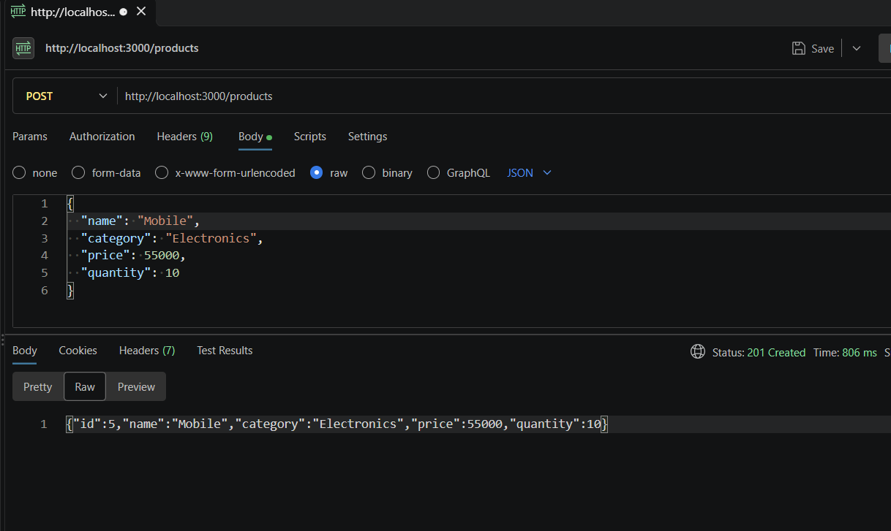
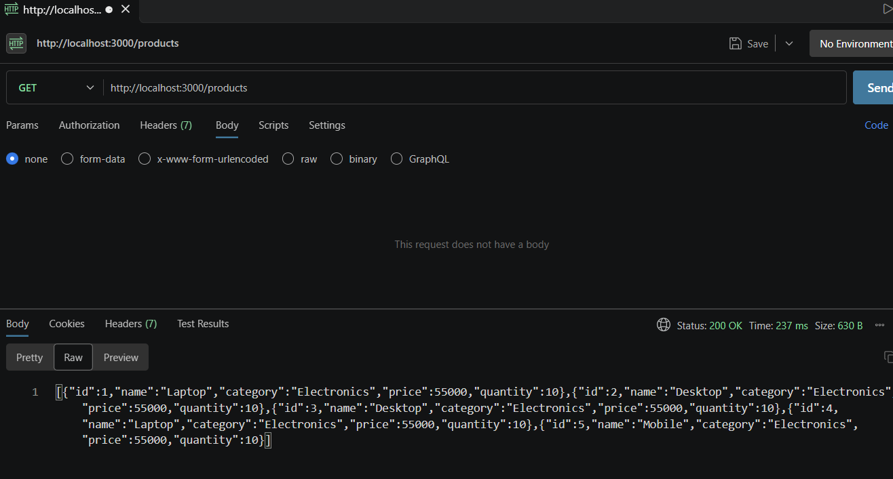
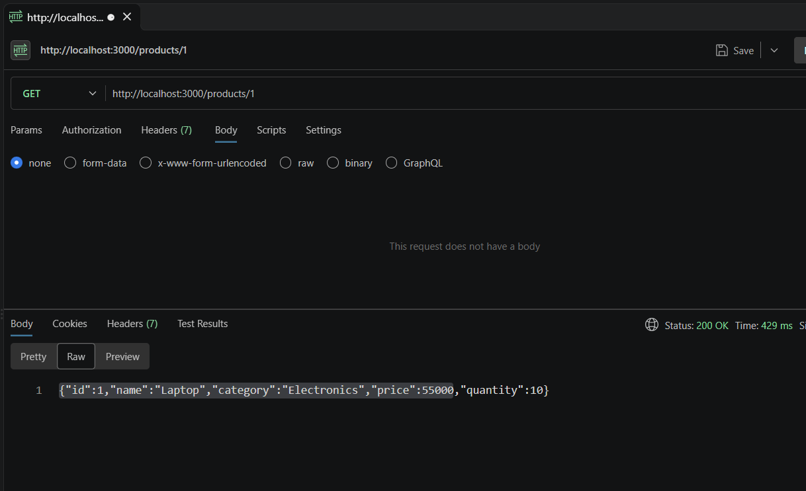
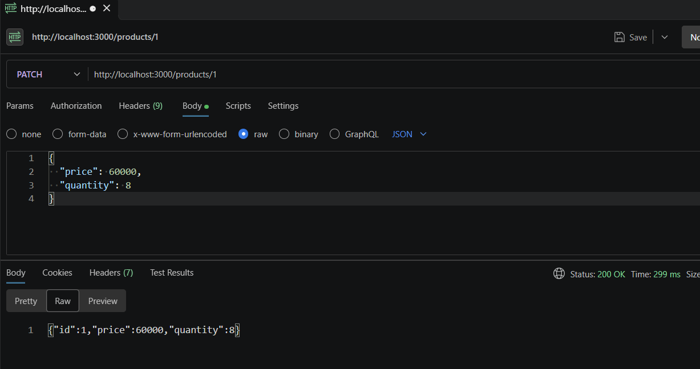
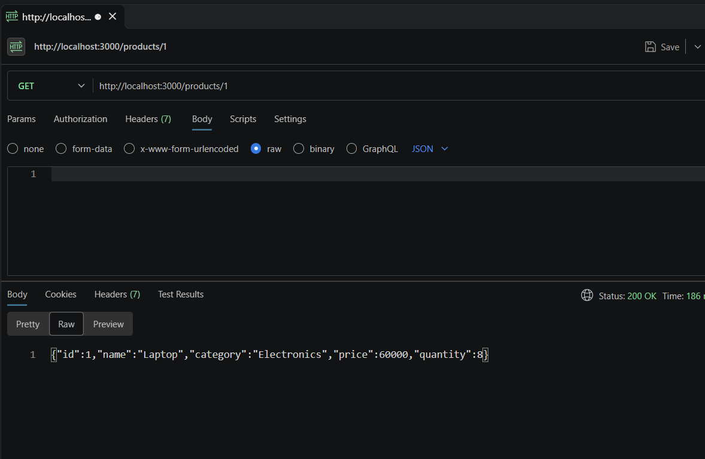
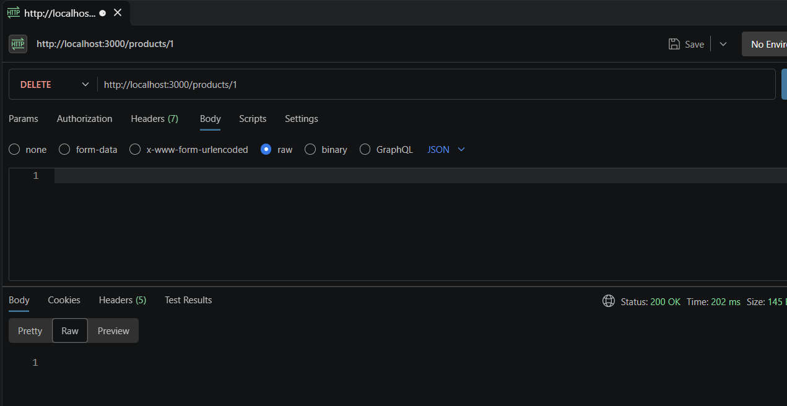
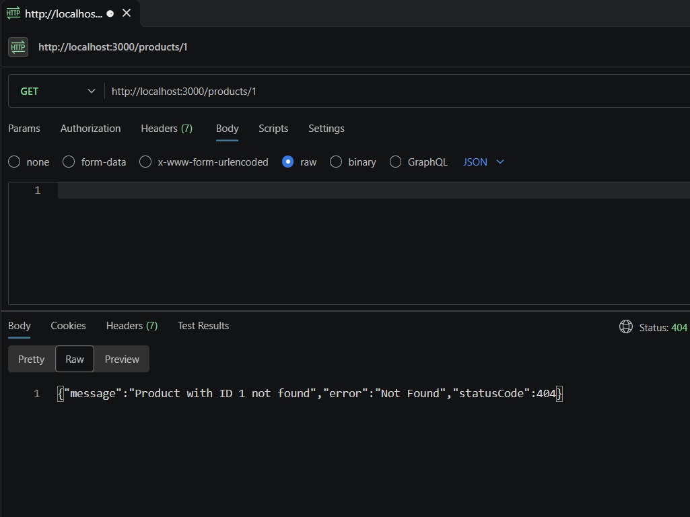

# Product Management System

## Student Details
- SL: 1
- Name: MD Arafat Rahman
- ID: 23-51459-1

## Project Overview
This project is a NestJS-based product and employee management application. It provides a clean REST API for managing product records and employee information with PostgreSQL as the database layer.

## Setup Instructions

### 1. Clone the repository
```bash
git clone https://github.com/rahman-arafat/ADVANCED-PROGRAMMING-IN-WEB-TECHNOLOGY-Fall-26-27-.git
cd ADVANCED-PROGRAMMING-IN-WEB-TECHNOLOGY-Fall-26-27-/mid/practice/product-management
```

### 2. Install dependencies
```bash
npm install
```

### 3. Configure environment variables
Create a `.env` file in the project root using the sample file:

```bash
cp .env.example .env
```

Update the database settings in `.env` to match your PostgreSQL setup:

```env
DB_HOST=localhost
DB_PORT=5432
DB_USERNAME=postgres
DB_PASSWORD=123
DB_DATABASE=product_management
```

### 4. Create the PostgreSQL database
Create a database named `product_management` in PostgreSQL, or change `DB_DATABASE` in `.env` to match your existing database.

### 5. Run the application
```bash
npm run start:dev
```

The app will run on the default NestJS port:

```bash
http://localhost:3000
```

### 6. Run tests (optional)
```bash
npm run test
```

## Screenshot Preview















## Technologies Used
- NestJS
- TypeScript
- PostgreSQL
- TypeORM
- Node.js

## Notes
This repository is organized as a project assignment and includes API examples and screenshots showing the CRUD workflow for product management.
